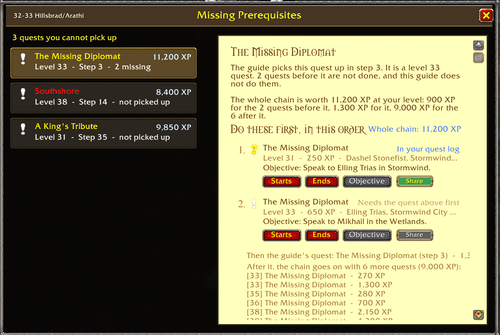

# RestedXP Blizzard Style

A World of Warcraft addon for WoW: Forever that shows [RestedXP Guides](https://www.restedxp.com/) in the style of Blizzard's quest tracker instead of the RestedXP guide window.

Requires the RestedXP Guides addon. This is an independent addon and is not made or supported by RestedXP.

## What you get

- The current step with its to-dos, and the upcoming steps below it, styled like a section of the quest tracker.
- A small info button next to a step's title shows the quests that follow the step's quests in their chains, and whether this guide does them. Needs Questie.
- Click the dash in front of a line to tick it off by hand. The two arrows in the header bar go to the previous or next step.
- Right-click the header bar for guides and RestedXP's own options.
- Shift-click an upcoming step to jump to it. Scroll over the upcoming steps to look further ahead.
- The guide sits directly below the quest tracker and moves with it in Edit Mode, or anywhere you drag it.
- Scale, width and height of the guide can be set (Options > AddOns > RestedXP Blizzard Style > Display). The height can also be set by dragging the yellow line that shows while the mouse is on the guide.
- Anchor Bottom turns the guide around like RestedXP's "Current step frame anchor": the current step at the bottom, the next steps above it.
- The current step is written below the waypoint arrow. If [TomTom](https://www.curseforge.com/wow/addons/tomtom) is installed, its arrow can point to the step instead.
- With [Questie](https://www.curseforge.com/wow/addons/questie): hovering a quest line shows Questie's tooltip for that quest.
- Missing Prerequisites (the quest-giver icon on the header bar, or `/rxpstyle prereqs`): every quest of the current guide you cannot pick up yet because a quest before it is not done and the guide does not do it, with the whole chain of quests that unlocks it, its objectives, the experience of the whole chain, and buttons to show where each quest starts, ends and is done on the map, or to share it. Needs Questie.

## Options

Open them with `/rxpstyle`, or in RestedXP's settings on the tab "Blizzard Style". Every feature can be switched off on its own.

## How it works

Nothing in the RXPGuides folder is changed, so RestedXP updates keep working. RestedXP's own windows stay alive but invisible, because they are what detects that a step is done, and this addon draws the same data in its own frames.

If a RestedXP update changes something this addon relies on, the affected part switches itself off with one chat message and the normal RestedXP window comes back.

## Install

Install from CurseForge, or copy the `RXPBlizzStyle` folder into `World of Warcraft\_forever_\Interface\AddOns\`. Restart the game afterwards, because `/reload` does not load new addons.

## Reporting problems

- The display or the options are wrong: click the "?" on the header bar (or type `/rxpstyle report`), copy the text and paste it into an [issue here](https://github.com/HexToolFactory/RXPBlizzStyle/issues).
- A guide step itself is wrong: right-click that step and choose "Give Feedback for step", or right-click the header bar and choose "Open Feedback Form". Both open the form of RestedXP.

## License

MIT
